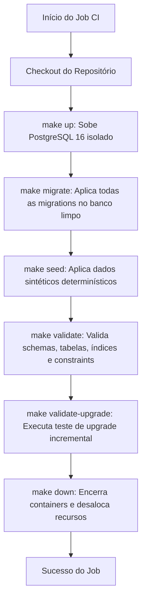

# Integração Contínua e Validação de Compatibilidade (DB-002)

Este documento descreve a especificação, arquitetura e execução da pipeline de Integração Contínua (CI) e das validações automatizadas de compatibilidade para o repositório `plataforma-database`, alinhado com as diretrizes da *ADR-011*, convenções da *DB-001* e as normas de governança da plataforma.

---

## 1. Contexto e Objetivos

A entrega **DB-002** implementa a automação de CI responsável por garantir a integridade, compatibilidade e reprodutibilidade do banco de dados relacional (PostgreSQL 16).

Os objetivos centrais incluem:
1. **Subida de banco limpo:** Provisionamento determinístico de uma instância PostgreSQL 16 isolada via Docker Compose.
2. **Instalação limpa (Clean Install):** Execução sequencial de todas as migrations ativas a partir do zero, aplicação de seeds sintéticos e verificação estrutural completa.
3. **Validação de upgrade incremental:** Simulação de um ambiente existente em versão anterior (baseline V0001) e aplicação das migrations subsequentes (V0002+), garantindo retrocompatibilidade sem perda de dados.
4. **Garantia de idempotência:** Reexecução de scripts de migração e seeds sem gerar erros ou duplicações em bancos já migrados.
5. **Validação de integridade e segurança:** Verificação de esquemas de domínio, integridade de tabelas, índices, check constraints e ausência de privilégios públicos indevidos (`PUBLIC`).

---

## 2. Arquitetura da Pipeline de CI

A pipeline é implementada através do GitHub Actions no arquivo [ci.yml](file:///.github/workflows/ci.yml).

### Disparadores (Triggers)
- **Push:** Todos os commits em qualquer branch e merges na branch `main`.
- **Pull Request:** Validação obrigatória para PRs com destino à branch `main`.
- **Workflow Dispatch:** Execução manual sob demanda.

### Etapas da Execução


1. **Provisionamento do Banco:** Executa `make up` (`docker compose up -d --wait`), aguardando o healthcheck oficial do PostgreSQL.
2. **Instalação Limpa:**
   - Executa `make migrate` (`./scripts/migrate.sh`).
   - Executa `make seed` (`./scripts/seed.sh`).
   - Executa `make validate` (`./scripts/validate.sh`).
3. **Validação de Upgrade Incremental:** Executa `make validate-upgrade` (`./scripts/validate_upgrade.sh`).
4. **Desalocação Limpa:** Executa `make down` (`docker compose down`) garantindo a finalização dos containers mesmo em caso de falha (`if: always()`).

---

## 3. Mecanismo de Migrations e Idempotência (`migrate.sh`)

O script [migrate.sh](file:///scripts/migrate.sh) foi aprimorado para garantir atomicidade, rastreabilidade e idempotência:
- Suporta as variáveis de ambiente `PGDATABASE` e `PGUSER` (com valor padrão `plataforma`).
- Consulta a tabela `public.schema_migration` antes de executar cada arquivo `migrations/*.sql`.
- Se a migration já foi registrada como aplicada, ela é ignorada com registro explicativo (`Migration VNNNN ja aplicada em <banco>, ignorando.`).
- Caso ainda não tenha sido aplicada, é executada com a opção `ON_ERROR_STOP=1`.

---

## 4. Validação de Upgrade Incremental (`validate_upgrade.sh`)

O script [validate_upgrade.sh](file:///scripts/validate_upgrade.sh) automatiza o ciclo completo de verificação de atualização:
1. Cria dinamicamente um banco isolado temporário (`plataforma_upgrade_test`).
2. Aplica apenas a migration baseline inicial (`V0001__create_domain_schemas.sql`).
3. Valida que o estado intermediário reflete exclusivamente a versão baseline.
4. Executa o `migrate.sh` padrão sobre o banco temporário, confirmando que o sistema reconhece a versão anterior e aplica apenas as migrações mais recentes (`V0002__create_audit_event.sql`).
5. Valida a idempotência executando o `migrate.sh` uma segunda vez, confirmando que não ocorrem erros nem duplicações.
6. Aplica os seeds determinísticos (`seed.sh`).
7. Executa a suíte de validação completa (`validate.sh`).
8. Remove com segurança o banco temporário de teste.

---

## 5. Verificações de Integridade e Postura de Segurança (`validate.sh`)

O script [validate.sh](file:///scripts/validate.sh) realiza 8 etapas de validação rigorosa:
1. **Schemas de domínio:** Confirma a existência de `auth`, `academic_pi`, `extension`, `assets` e `institutional`.
2. **Tabela de versionamento:** Confirma a criação de `public.schema_migration`.
3. **Histórico de migrações:** Confirma o registro das versões `V0001` e `V0002`.
4. **Tabela de auditoria:** Confirma a existência de `public.audit_event`.
5. **Índices de desempenho:** Confirma a presença de:
   - `idx_audit_event_actor`
   - `idx_audit_event_occurred_at`
   - `idx_audit_event_record`
6. **Check Constraints:** Confirma as restrições:
   - `audit_event_operation_ck` (INSERT, UPDATE, DELETE)
   - `audit_event_schema_name_ck` (não vazio)
   - `audit_event_table_name_ck` (não vazio)
7. **Postura de segurança (ADR-011):** Garante que o role `PUBLIC` possui zero privilégios de `USAGE` ou `CREATE` nos schemas de domínio.
8. **Validação funcional de constraints:** Testa a rejeição ativa de operações inválidas por violação de constraint via bloco `DO $$ ... $$`.

---

## 6. Estratégia de Rollback e Segurança Operacional

Conforme definido na DB-001 e alinhado à governança da plataforma:
1. **Imutabilidade:** Arquivos de migrations já mesclados na branch `main` são imutáveis e jamais devem ser editados.
2. **Roll-forward por padrão:** Qualquer correção ou ajuste em schema em ambientes integrados e produção deve ser realizado através de uma nova migração sequencial incremental (ex.: `V0003__...`).
3. **Padrão Expand and Contract:** Operações que alteram estruturas existentes sem downtime seguem as três etapas:
   - *Expand:* Criação da nova estrutura coexistindo com a anterior.
   - *Transition:* Adaptação do código da aplicação e backfill dos dados.
   - *Contract:* Remoção segura dos artefatos legados após descontinuação do uso.
4. **Recuperação de Desastres (PITR):** Antes de qualquer intervenção estrutural de grande porte em produção, backups completos e estratégias de Point-in-Time Recovery (PITR) são obrigatórios para restauração em caso de anomalia catastrófica.

---

## 7. Como Executar Localmente

Com o Docker e Docker Compose instalados e em execução:

```bash
# 1. Sobe o banco PostgreSQL 16
make up

# 2. Aplica as migrations incrementais
make migrate

# 3. Aplica os seeds determinísticos sintéticos
make seed

# 4. Executa as validações estruturais e de segurança
make validate

# 5. Executa a validação de upgrade incremental e idempotência
make validate-upgrade

# 6. Ou executa todos os testes conjuntamente
make test

# 7. Finaliza e limpa os containers locais
make down
```
