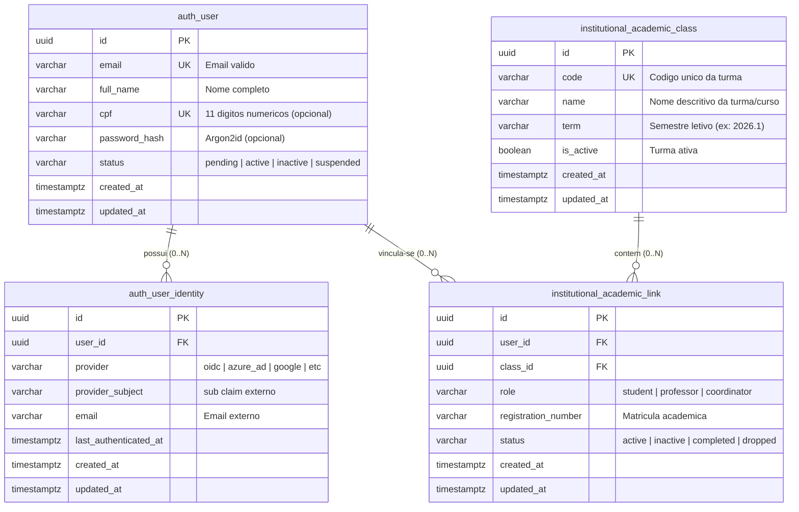

# Identidade, Usuário e Vínculo Acadêmico (DB-004)

Este documento estabelece a especificação arquitetural, modelo de dados relacional, diretrizes de integridade, estratégia de migração e conformidade regulatória para a gestão de identidades, usuários e vínculos acadêmicos no repositório `plataforma-database`, em estrito alinhamento com a **ADR-002**, **ADR-003**, **ADR-011**, convenções da **DB-001**, automações da **DB-002**, **DB-003** e as especificações de governança **SPEC-AUTH-001** e **PG-005/PG-006**.

---

## 1. Contexto e Alinhamento com a Governança

A entrega **DB-004** implementa a modelagem relacional dos núcleos de identidade, usuário e vinculação acadêmica/turmas no banco de dados PostgreSQL 16.

### 1.1 Resolução das Dependências de Decisão

A especificação de produto e o caderno de alinhamento propuseram diretrizes para autenticação e provisionamento institucional que foram reconciliadas com a autoridade normativa da plataforma:

| Tema em Alinhamento | Decisão e Modelagem Arquitetural Adotada | Fundamentação Normativa |
| :--- | :--- | :--- |
| **Fonte de Identidade vs. Conta Local** | Desacoplamento estrutural entre a conta de usuário (`auth.user`) e suas credenciais ou identidades federadas (`auth.user_identity`). A arquitetura suporta tanto o login federado institucional (OIDC / OAuth2) quanto autenticação local com hash Argon2id (coluna `password_hash` opcional). | **ADR-003** (SSO/IAM OIDC/JWT RS256), **POL-SEC-001**, **MH-SEC-001** |
| **Identificador e Normalização do CPF** | Campo `cpf varchar(11)` estritamente normalizado com CHECK constraint `(cpf IS NULL OR cpf ~ '^[0-9]{11}$')` e índice/restrição de unicidade global `user_cpf_unq`. O campo é anulável (`NULL`) para suportar contas federadas puras sem CPF cadastrado ou contas de serviço, mas possui unicidade estrita quando preenchido. | **PG-005**, **SPEC-AUTH-001**, Minimização LGPD |
| **Provisionamento e Reimportação CSV** | A modelagem permite idempotência na importação. O vínculo de turma possui restrição de unicidade composta `(user_id, class_id, role)`, prevenindo duplicidades em reimportações parciais ou totais. A coluna `registration_number` armazena a matrícula acadêmica original do CSV. | **PG-006**, **SPEC-AUTH-001** |
| **Estados da Conta (Status)** | Coluna `status` em `auth.user` com CHECK constraint exigindo valores em: `'pending'` (provisionado via CSV aguardando ativação/primeiro acesso), `'active'` (ativo), `'inactive'` (desativado pela coordenação), `'suspended'` (suspenso). | **SPEC-AUTH-001**, **PG-006** |
| **Estados do Vínculo Acadêmico** | Coluna `status` em `institutional.academic_link` com CHECK constraint: `'active'`, `'inactive'`, `'completed'`, `'dropped'`. Permite ativar, desativar ou encerrar a participação do aluno em determinada turma sem apagar seu histórico ou conta. | **SPEC-AUTH-001**, **PG-006** |
| **Múltiplas Turmas por Conta** | A relação entre usuário e turma é 1:N (um usuário pode possuir múltiplos registros em `institutional.academic_link` para turmas distintas), atendendo formalmente ao requisito de estudante matriculado em mais de uma turma. | **SPEC-PI-001**, **PG-006** |
| **Comportamento sem Vínculo** | O usuário em `auth.user` não exige dependência de chave estrangeira com turmas (relação 0..N). Usuários administrativos, CPA ou recém-cadastrados sem turma operam de maneira desacoplada. | **SPEC-AUTH-003**, **PG-006** |

---

## 2. Diagrama Entidade-Relacionamento



---

## 3. Especificação Detalhada das Tabelas

### 3.1 `auth.user`
Armazena os dados cadastrais canônicos e o ciclo de vida da conta do usuário.

- **Colunas:**
  - `id` (`uuid`, PK): Identificador universal gerado pela aplicação cliente.
  - `email` (`varchar(255)`, NOT NULL, UNIQUE): E-mail do usuário.
  - `full_name` (`varchar(255)`, NOT NULL): Nome completo com comprimento mínimo de 2 caracteres não-vazios.
  - `cpf` (`varchar(11)`, UNIQUE, NULLABLE): CPF normalizado estritamente como 11 dígitos numéricos (`^[0-9]{11}$`).
  - `password_hash` (`varchar(255)`, NULLABLE): Hash da senha com Argon2id para contas locais. Nullable para contas com autenticação exclusivamente OIDC/SSO federado.
  - `status` (`varchar(20)`, NOT NULL, DEFAULT `'pending'`): Estado da conta (`'pending'`, `'active'`, `'inactive'`, `'suspended'`).
  - `created_at` (`timestamptz`, NOT NULL, DEFAULT `now()`): Timestamp de criação em UTC.
  - `updated_at` (`timestamptz`, NOT NULL, DEFAULT `now()`): Timestamp de última atualização em UTC.
- **Restrições de Integridade (Check Constraints):**
  - `user_email_ck`: Validação sintática de formato de e-mail.
  - `user_full_name_ck`: Rejeição de strings vazias ou com espaços em branco apenas.
  - `user_cpf_ck`: Exige exatamente 11 dígitos numéricos quando preenchido.
  - `user_password_hash_ck`: Impede strings vazias no hash de senha quando preenchido.
  - `user_status_ck`: Enumeração estrita de status válidos.
- **Índices de Desempenho:**
  - `idx_user_email`: Otimização para autenticação e consultas por e-mail.
  - `idx_user_status`: Filtragem de contas por estado operacional.
  - `idx_user_cpf`: Busca e garantia de unicidade de CPF.

### 3.2 `auth.user_identity`
Mapeia identidades institucionais externas fornecidas via protocolo OIDC/OAuth2 para a conta central do usuário.

- **Colunas:**
  - `id` (`uuid`, PK): Identificador da identidade.
  - `user_id` (`uuid`, NOT NULL, FK): Referência para `auth.user(id)` com exclusão em cascata (`ON DELETE CASCADE`).
  - `provider` (`varchar(50)`, NOT NULL): Identificador do IdP (ex.: `'oidc'`, `'azure_ad'`, `'google'`).
  - `provider_subject` (`varchar(255)`, NOT NULL): Identificador único do sujeito no IdP (claim `sub`).
  - `email` (`varchar(255)`, NULLABLE): E-mail retornado pelo IdP externo.
  - `last_authenticated_at` (`timestamptz`, NULLABLE): Data/hora do último handshake bem-sucedido.
  - `created_at` / `updated_at` (`timestamptz`, NOT NULL, DEFAULT `now()`).
- **Restrições de Integridade:**
  - `user_identity_user_fk`: Integridade referencial com a tabela `auth.user`.
  - `user_identity_provider_ck` / `user_identity_provider_subject_ck`: Rejeição de valores em branco.
  - `user_identity_email_ck`: Validação de e-mail opcional.
  - `user_identity_provider_subject_unq`: Unicidade composta `(provider, provider_subject)` impedindo duplicidades externas.
- **Índices de Desempenho:**
  - `idx_user_identity_user_id`: Junções entre conta e identidades.
  - `idx_user_identity_provider_subject`: Resolução de login em O(1) pelo provedor federado.

### 3.3 `institutional.academic_class`
Representa turmas, classes acadêmicas e agrupamentos de alunos sob coordenação.

- **Colunas:**
  - `id` (`uuid`, PK): Chave primária UUID.
  - `code` (`varchar(50)`, NOT NULL, UNIQUE): Código institucional único da turma (ex.: `'TURMA-2026-ENG-01'`).
  - `name` (`varchar(255)`, NOT NULL): Nome legível do curso/turma.
  - `term` (`varchar(20)`, NOT NULL): Semestre/período letivo de referência (ex.: `'2026.1'`).
  - `is_active` (`boolean`, NOT NULL, DEFAULT `true`): Sinalizador de atividade da turma.
  - `created_at` / `updated_at` (`timestamptz`, NOT NULL, DEFAULT `now()`).
- **Restrições de Integridade:**
  - `academic_class_code_ck`, `academic_class_name_ck`, `academic_class_term_ck`: Prevenção de strings vazias.
  - `academic_class_code_unq`: Unicidade do código da turma.
- **Índices de Desempenho:**
  - `idx_academic_class_code`: Busca rápida por código.
  - `idx_academic_class_term`: Filtragem por período/semestre letivo.
  - `idx_academic_class_is_active`: Filtragem de turmas vigentes.

### 3.4 `institutional.academic_link`
Materializa a associação entre uma pessoa/usuário e uma turma/instituição, registrando seu papel acadêmico e estado da matrícula.

- **Colunas:**
  - `id` (`uuid`, PK): Chave primária UUID.
  - `user_id` (`uuid`, NOT NULL, FK): Referência para `auth.user(id)` com `ON DELETE CASCADE`.
  - `class_id` (`uuid`, NOT NULL, FK): Referência para `institutional.academic_class(id)` com `ON DELETE RESTRICT` (impede exclusão acidental de turma com alunos vinculados).
  - `role` (`varchar(30)`, NOT NULL, DEFAULT `'student'`): Papel institucional no vínculo (`'student'`, `'professor'`, `'coordinator'`).
  - `registration_number` (`varchar(50)`, NULLABLE): Matrícula acadêmica (RA).
  - `status` (`varchar(20)`, NOT NULL, DEFAULT `'active'`): Situação do vínculo (`'active'`, `'inactive'`, `'completed'`, `'dropped'`).
  - `created_at` / `updated_at` (`timestamptz`, NOT NULL, DEFAULT `now()`).
- **Restrições de Integridade:**
  - `academic_link_user_fk`: Vínculo referencial com o usuário.
  - `academic_link_class_fk`: Vínculo referencial com a turma.
  - `academic_link_role_ck`: Restrição para papéis autorizados.
  - `academic_link_status_ck`: Restrição para situações operacionais válidas.
  - `academic_link_registration_number_ck`: Prevenção de matrícula vazia se preenchida.
  - `academic_link_user_class_role_unq`: Unicidade composta `(user_id, class_id, role)`, prevenindo duplicidades em importações CSV, mas permitindo o mesmo usuário em mais de uma turma.
- **Índices de Desempenho:**
  - `idx_academic_link_user_id`: Listagem de vínculos de um usuário.
  - `idx_academic_link_class_id`: Listagem de alunos/docentes de uma turma.
  - `idx_academic_link_status`: Filtragem de vínculos ativos vs inativos.

---

## 4. Estratégia de Migração e Upgrade

### 4.1 Migration Incremental (`V0003`)
A migração [V0003__create_identity_user_and_academic_link.sql](file:///migrations/V0003__create_identity_user_and_academic_link.sql) foi concebida de forma atômica e idempotente:
- Executada dentro de bloco transacional (`BEGIN; ... COMMIT;`).
- Cláusulas de proteção `CREATE TABLE IF NOT EXISTS`, `CREATE INDEX IF NOT EXISTS`.
- Registro formal no catálogo de versões (`public.schema_migration`) com `ON CONFLICT (version) DO NOTHING`.

### 4.2 Compatibilidade e Validação de Upgrade
A migração foi validada para ambos os cenários:
1. **Instalação Limpa (Clean Install):** Aplicação de `V0001` → `V0002` → `V0003` sequencialmente em container PostgreSQL 16 a partir do zero.
2. **Upgrade Incremental:** Simulação automatizada via [scripts/validate_upgrade.sh](file:///scripts/validate_upgrade.sh) a partir da versão baseline anterior (`V0001`), validando que o `migrate.sh` detecta o estado intermediário e aplica `V0002` e `V0003` sem anomalias, garantindo total idempotência sob repetições.

---

## 5. Estratégia de Rollback Seguro e Recuperação (Expand and Contract)

Conforme a **ADR-011** e **DB-001**:
1. **Roll-forward por Padrão:** Qualquer ajuste posterior no modelo de dados deve ser executado através de uma nova migração sequencial incremental (`V0004__...`).
2. **Imutabilidade de Migrations:** Migrações publicadas jamais sofrem alterações diretas em seus arquivos de origem.
3. **Padrão Expand and Contract para Modificações Estruturais:**
   - *Fase Expand:* Criação de colunas ou tabelas alternativas coexistindo com as vigentes.
   - *Fase Transition:* Migração dos dados via rotinas de backfill e atualização dos serviços consumidores.
   - *Fase Contract:* Remoção ordenada das estruturas legadas após verificação completa de tráfego zero.
4. **Proteção Contra Perda de Dados Válidos:** A exclusão física de colunas ou tabelas nunca é executada em scripts normais de rollback. Em caso de desastre operacional em produção, o restabelecimento é realizado através de Point-in-Time Recovery (PITR) a partir do backup gerenciado do RDS PostgreSQL.

---

## 6. Diretrizes de Seeds e Proteção de Dados (LGPD)

O arquivo de seeds sintéticos [seeds/0002_identity_user_link.sql](file:///seeds/0002_identity_user_link.sql) segue rigorosamente a política Anti-PII:
- **Identificadores Constantes e Determinísticos:** UUIDs previsíveis mapeados com as chaves de auditoria (`b0000000-0000-4000-8000-000000000001` até `...0005`).
- **Dados Fictícios e Sintéticos:** Todos os e-mails utilizam o sufixo não-roteável `@synthetic.local`. Nenhum dado pessoal real ou sensível de estudantes, docentes ou servidores é utilizado.
- **Validação Automatizada de Privacidade:** O script `scripts/validate.sh` inspeciona continuamente as tabelas `auth.user` e `auth.user_identity`, rejeitando domínios públicos de e-mail ou formatos de dados pessoais reais.
- **Cenários Cobertos:** Contas ativas, contas provisionadas pendentes (`status = 'pending'`), contas vinculadas a múltiplas turmas, contas com vínculos inativados e contas completamente desacopladas de turmas (usuário sem vínculo).

---

## 7. Comandos de Verificação Local

```bash
# 1. Provisiona banco limpo
make up

# 2. Executa as migrações (incluindo V0003)
make migrate

# 3. Injeta seeds sintéticos determinísticos (0001 e 0002)
make seed

# 4. Executa a suíte completa de validação de schemas, tabelas, constraints e seeds
make validate

# 5. Executa o teste de upgrade incremental a partir da baseline e teste de idempotência
make validate-upgrade

# 6. Executa todos os testes conjuntamente
make test

# 7. Finaliza e desaloca recursos locais
make down
```
