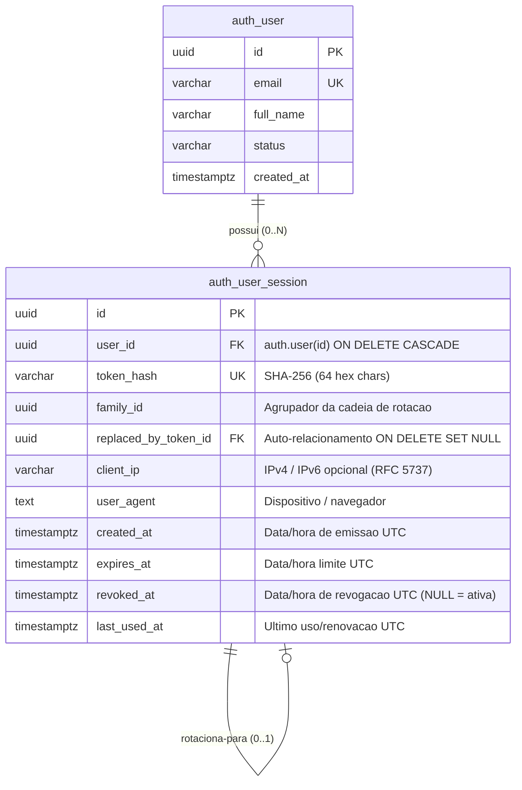

# Sessões, Hash, Expiração, Revogação e Rotação de Tokens (DB-005)

Este documento estabelece a especificação técnica, modelo de dados relacional, diretrizes de integridade, estratégia de segurança e procedimentos de migração e rollback para o gerenciamento de sessões de usuário e tokens de renovação (*refresh tokens*) no repositório `plataforma-database`, em estrito alinhamento com a **ADR-002**, **ADR-003**, **ADR-011**, convenções da **DB-001**, automações da **DB-002**, **DB-003**, **DB-004** e as normas de governança **SPEC-AUTH-002** e **MH-SEC-004**.

---

## 1. Contexto e Objetivos

A entrega **DB-005** implementa a modelagem relacional responsável pela persistência e ciclo de vida de sessões autenticadas e controle server-side de *refresh tokens* no PostgreSQL 16 da Plataforma Digital do UniSENAI Sorocaba.

### 1.1 Resolução e Desacoplamento das Diretrizes de Governança

A especificação de produto [SPEC-AUTH-002](https://github.com/UniSENAI-Sorocaba/plataforma-governance/blob/docs/regras-caderno-perguntas-respostas/_KB/specs/SPEC-AUTH-002-session.md) e as decisões de arquitetura da plataforma impõem requisitos rígidos de segurança reconciliados no modelo relacional:

| Tema Normativo | Decisão e Modelagem Arquitetural Adotada | Fundamentação Normativa |
| :--- | :--- | :--- |
| **Proteção Anti-Vazamento de Tokens** | **Nunca persistir tokens em texto puro.** Apenas o hash criptográfico SHA-256 do refresh token (`token_hash varchar(64) NOT NULL UNIQUE`) é armazenado. | **MH-SEC-004**, **ADR-003**, **SPEC-AUTH-002** |
| **Access Tokens Stateless** | Os *access tokens* (JWT RS256 de 15 minutos) são validados via chave pública na aplicação cliente/backend e **não são persistidos no banco de dados**, eliminando sobrecarga e consultas redundantes. | **ADR-003**, **SPEC-AUTH-001** |
| **Rotação de Refresh Tokens (Token Rotation)** | Suporte completo à cadeia de rotação através de `family_id uuid NOT NULL` (agrupamento da árvore de tokens) e `replaced_by_token_id uuid` (apontamento auto-referencial para o token sucessor). | **AC-AUTH-002-01**, **SPEC-AUTH-002** |
| **Detecção de Reutilização (Reuse Detection)** | Se um refresh token já rotacionado (`revoked_at IS NOT NULL` e `replaced_by_token_id IS NOT NULL`) for apresentado para renovação, a aplicação consulta por `family_id` e invalida imediatamente todas as sessões daquela família. | **AC-AUTH-002-03**, **SPEC-AUTH-002** |
| **Logout Centralizado e Revogação** | Campo `revoked_at timestamptz` (em UTC). Um valor não-nulo indica invalidação definitiva da sessão. Suporta tanto logout pontual quanto encerramento global de sessões do usuário. | **AC-AUTH-002-04**, **SPEC-AUTH-002** |
| **Flexibilidade de Políticas de Expiração** | A duração exata (inatividade vs absoluta) não é fixada com valores hardcoded no banco; o schema apenas impõe a constraint de integridade temporal `expires_at > created_at`, mantendo o banco desacoplado das parametrizações dinâmicas da aplicação. | **SPEC-AUTH-002**, **PG-006** |
| **Auditoria e Rastreabilidade** | Eventos de criação, rotação e encerramento de sessão são integrados à trilha de auditoria (`public.audit_event`), referenciando `schema_name = 'auth'`, `table_name = 'user_session'`, `record_id` e `actor_id`. | **ADR-011**, **SPEC-AUTH-004** |

---

## 2. Diagrama Entidade-Relacionamento



---

## 3. Especificação Detalhada da Tabela `auth.user_session`

### 3.1 Definição de Colunas
- `id` (`uuid`, PRIMARY KEY): Identificador universal único da sessão gerado pela aplicação.
- `user_id` (`uuid`, NOT NULL): Referência para o usuário titular em `auth.user(id)` com remoção em cascata (`ON DELETE CASCADE`).
- `token_hash` (`varchar(64)`, NOT NULL, UNIQUE): Hash criptográfico SHA-256 do refresh token emitido, formatado estritamente como 64 caracteres hexadecimais.
- `family_id` (`uuid`, NOT NULL): Identificador da linhagem/família do refresh token. Permanece idêntico ao longo de sucessivas rotações da mesma sessão primária.
- `replaced_by_token_id` (`uuid`, NULLABLE): Chave estrangeira auto-referencial (`REFERENCES auth.user_session(id) ON DELETE SET NULL`) apontando para a nova sessão gerada pela rotação.
- `client_ip` (`varchar(45)`, NULLABLE): Endereço IP do cliente associado à criação da sessão (suporta formatos IPv4 e IPv6).
- `user_agent` (`text`, NULLABLE): Cabeçalho `User-Agent` do navegador/dispositivo que originou a sessão.
- `created_at` (`timestamptz`, NOT NULL, DEFAULT `now()`): Timestamp de emissão da sessão em UTC.
- `expires_at` (`timestamptz`, NOT NULL): Timestamp limite de validade do refresh token em UTC.
- `revoked_at` (`timestamptz`, NULLABLE): Timestamp da revogação ou substituição da sessão em UTC (`NULL` indica sessão ativa/não revogada).
- `last_used_at` (`timestamptz`, NULLABLE): Timestamp da última operação de renovação ou verificação bem-sucedida.

### 3.2 Restrições de Integridade (Constraints)
- `user_session_user_fk`: Foreign Key para `auth.user(id)` com `ON DELETE CASCADE`. Garante que a exclusão da conta do usuário remova todas as suas sessões e tokens ativos.
- `user_session_replaced_by_token_fk`: Foreign Key auto-referencial para `auth.user_session(id)` com `ON DELETE SET NULL`. Preserva a integridade relacional da árvore de sucessão.
- `user_session_token_hash_ck`: CHECK constraint garantindo que `token_hash` não seja vazio e possua exatamente 64 caracteres (`CHECK (token_hash <> '' AND length(token_hash) = 64)`).
- `user_session_expires_at_ck`: CHECK constraint assegurando que a data de expiração seja estritamente posterior à data de emissão (`CHECK (expires_at > created_at)`).
- `user_session_token_hash_unq`: Restrição de unicidade para o hash do token (`UNIQUE (token_hash)`).

### 3.3 Índices de Desempenho e Boas Práticas
- **Sem Índice Redundante para `token_hash`:** A restrição `UNIQUE` já provisiona automaticamente um índice B-Tree único no PostgreSQL. Não é criado índice secundário manual, evitando sobrecarga de escrita.
- `idx_user_session_user_id`: B-Tree em `(user_id)` para acelerar consultas de sessões de um usuário específico e operações de logout em lote.
- `idx_user_session_family_id`: B-Tree em `(family_id)` para localização imediata de toda a família de tokens quando um reuso for detectado.
- `idx_user_session_active_lookup`: Índice parcial determinístico projetado para buscas de sessões ativas:
  ```sql
  CREATE INDEX IF NOT EXISTS idx_user_session_active_lookup
      ON auth.user_session (user_id, expires_at)
      WHERE revoked_at IS NULL;
  ```
  *Nota Crítica de Desempenho e Imutabilidade:* O índice não inclui a função `now()` no predicado `WHERE`, respeitando a exigência de funções estritamente `IMMUTABLE` no PostgreSQL e permitindo que o planejador de consultas filtre `expires_at > now()` em tempo de execução com máxima eficiência.

---

## 4. Estratégia de Migração e Upgrade

### 4.1 Migration Incremental (`V0004`)
A migração [V0004__create_user_session.sql](file:///migrations/V0004__create_user_session.sql) segue rigorosamente o princípio da imutabilidade:
- Execução estritamente atômica delimitada por bloco de transação (`BEGIN; ... COMMIT;`).
- Cláusulas defensivas de proteção: `CREATE TABLE IF NOT EXISTS`, `CREATE INDEX IF NOT EXISTS`.
- Registro no catálogo de migrações com idempotência: `INSERT INTO public.schema_migration (version, description) VALUES ('V0004', 'create user session') ON CONFLICT (version) DO NOTHING;`.

### 4.2 Verificação de Instalação Limpa e Upgrade Incremental
A validação automatizada cobre os dois fluxos obrigatórios de governança:
1. **Instalação Limpa (Clean Install):** Execução ordenada `V0001` → `V0002` → `V0003` → `V0004` a partir do zero em container isolado PostgreSQL 16.
2. **Upgrade Incremental:** Simulação via [scripts/validate_upgrade.sh](file:///scripts/validate_upgrade.sh), iniciando a partir do baseline `V0001` e aplicando as migrações subsequentes com validação de idempotência em múltiplas execuções consecutivas.

---

## 5. Estratégia Segura de Rollback (Expand and Contract)

Em conformidade com a **ADR-011** e **DB-001**:
1. **Roll-forward por Padrão:** Correções estruturais ou acréscimos posteriores devem ser efetuados via novas migrações sequenciais (`V0005__...`).
2. **Imutabilidade:** Migrações já publicadas em branches compartilhadas (`develop`/`main`) jamais sofrem alterações manuais.
3. **Padrão Expand and Contract:**
   - *Expand:* Criação de novas estruturas ou colunas sem desativar a estrutura anterior.
   - *Transition:* Adaptação do código do backend e sincronização gradual de dados.
   - *Contract:* Desativação e remoção ordenada da estrutura antiga após descontinuação completa de uso.
4. **Recuperação de Desastres:** Em ambientes produtivos, a recuperação contra corrupção catastrófica de dados é suportada por Point-in-Time Recovery (PITR) a partir dos backups do RDS.

---

## 6. Dados Sintéticos (Seeds) e Conformidade LGPD

O arquivo [seeds/0003_user_session.sql](file:///seeds/0003_user_session.sql) cumpre estritamente as diretrizes Anti-PII:
- **Identificadores Determinísticos:** UUIDs na faixa `c0000000-0000-4000-8000-%` e famílias na faixa `d0000000-0000-4000-8000-%`.
- **Hashes Mockados:** Hashes SHA-256 sintéticos gerados para testes.
- **Isolamento de Rede:** IPs sintéticos pertencentes ao bloco de documentação da RFC 5737 (`192.0.2.x`).
- **Validação Automatizada:** O script `scripts/validate.sh` inspeciona continuamente a tabela `auth.user_session` garantindo a inexistência de dados sensíveis reais.
