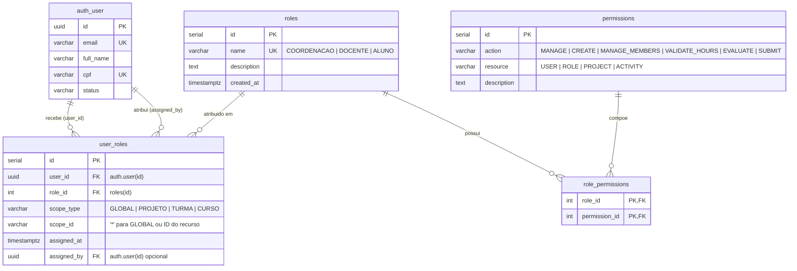

# Papéis, Permissões e Escopos de Autorização RBAC (DB-006)

Este documento estabelece a especificação arquitetural, o modelo de dados relacional, as restrições de integridade, os índices de consulta, a estratégia de migração/upgrade e a política de rollback seguro para o modelo de Controle de Acesso Baseado em Papéis e Escopos (RBAC) no repositório `plataforma-database`, em estrito alinhamento com a **ADR-002**, **ADR-003**, **ADR-011**, convenções da **DB-001**, dependência **DB-004** (`auth.user`), **SPEC-AUTH-003 (Autorização RBAC)**, **MH-SEC-002** e o **Caderno de Validações de Escopo**.

---

## 1. Contexto e Alinhamento com a Governança

A entrega **DB-006** modela e persiste os papéis (`roles`), as permissões atômicas (`permissions`), a matriz de associação (`role_permissions`) e as atribuições de papéis a usuários com suporte a escopo (`user_roles`).

### 1.1 Decisões Arquiteturais e Regras Oficiais Atendidas

| Tema em Alinhamento | Decisão e Modelagem Arquitetural Adotada | Fundamentação Normativa |
| :--- | :--- | :--- |
| **Cadastro Único por CPF e Acúmulo de Papéis** | Cada pessoa possui um cadastro único em `auth.user` (`DB-004`). Uma mesma conta pode receber múltiplas atribuições em `user_roles` (ex.: `COORDENACAO` + `DOCENTE`), acumulando a união das permissões sem duplicar conta de usuário. | **SPEC-AUTH-003 (AC-AUTH-003-01)**, Caderno de Validações |
| **Prevenção de Duplicidade** | Restrições de unicidade garantem ausência de duplicatas em papéis (`roles_name_key`), permissões (`uk_permissions_action_resource (action, resource)`), matriz N:N (`PRIMARY KEY (role_id, permission_id)`) e atribuições por escopo (`uk_user_role_scope (user_id, role_id, scope_type, scope_id)`). | **Issue #6 (DB-006)**, **SPEC-AUTH-003** |
| **Suporte a Escopos e Consistência Semântica** | A tabela `user_roles` suporta escopo global (`scope_type = 'GLOBAL'`, `scope_id = '*'`) e escopos de domínio (`'PROJETO'`, `'TURMA'`, `'CURSO'` com `scope_id` específico). A constraint `user_roles_scope_consistency_ck` impede combinações ambíguas (como `GLOBAL` com ID diferente de `'*'` ou escopo específico com curinga `'*'`), evitando duplicidades disfarçadas. | **SPEC-AUTH-003 (AC-AUTH-003-02, AC-AUTH-003-03, AC-AUTH-003-05)** |
| **Integridade Referencial com `auth.user` (DB-004)** | `user_roles.user_id` referencia `auth.user(id)` com `ON DELETE CASCADE` (`user_roles_user_fk`) e `user_roles.assigned_by` referencia `auth.user(id)` com `ON DELETE SET NULL` (`user_roles_assigned_by_fk`). | **DB-004**, **DB-006** |
| **Negação por Padrão (Default Deny)** | A ausência de registro na matriz `role_permissions` ou de vínculo em `user_roles` para o escopo avaliado implica negação da operação server-side pela camada de aplicação. | **SPEC-AUTH-003 (AC-AUTH-003-06)**, **MH-SEC-002**, **POL-SEC-001** |

---

## 2. Diagrama Entidade-Relacionamento

---

## 3. Especificação Detalhada das Tabelas

### 3.1 `roles`
Catálogo de papéis institucionais e funcionais do sistema.

- **Colunas:**
  - `id` (`serial`, PK): Identificador único do papel.
  - `name` (`varchar(50)`, NOT NULL, UNIQUE): Código canônico do papel (`'COORDENACAO'`, `'DOCENTE'`, `'ALUNO'`).
  - `description` (`text`, NULLABLE): Descrição da responsabilidade institucional.
  - `created_at` (`timestamptz`, NOT NULL, DEFAULT `CURRENT_TIMESTAMP`): Data/hora de criação.
- **Restrições de Integridade:**
  - `roles_name_key`: Unicidade do nome do papel.
  - `roles_name_ck`: Impede nomes vazios ou compostos apenas por espaços (`length(trim(name)) > 0`).

### 3.2 `permissions`
Catálogo de permissões atômicas expressas como pares `(action, resource)`.

- **Colunas:**
  - `id` (`serial`, PK): Identificador único da permissão.
  - `action` (`varchar(50)`, NOT NULL): Verbo/operação autorizada.
  - `resource` (`varchar(50)`, NOT NULL): Recurso alvo da operação.
  - `description` (`text`, NULLABLE): Finalidade operacional da permissão.
- **Restrições de Integridade:**
  - `permissions_action_ck`: Impede ação vazia (`length(trim(action)) > 0`).
  - `permissions_resource_ck`: Impede recurso vazio (`length(trim(resource)) > 0`).
  - `uk_permissions_action_resource`: Unicidade composta `(action, resource)` prevenindo duplicidade de permissões.

### 3.3 `role_permissions`
Tabela associativa N:N entre papéis e permissões.

- **Colunas e Restrições:**
  - `role_id` (`int`, NOT NULL, FK `roles(id) ON DELETE CASCADE`).
  - `permission_id` (`int`, NOT NULL, FK `permissions(id) ON DELETE CASCADE`).
  - Chave primária composta `(role_id, permission_id)`, garantindo que uma permissão não seja associada em duplicidade ao mesmo papel.
- **Índices de Desempenho:**
  - `idx_role_permissions_role`: Busca rápida das permissões de um papel.
  - `idx_role_permissions_permission`: Busca reversa de papéis que detêm uma permissão.

### 3.4 `user_roles`
Materializa a atribuição de papéis aos usuários de `auth.user` com qualificador de escopo.

- **Colunas:**
  - `id` (`serial`, PK): Identificador da atribuição.
  - `user_id` (`uuid`, NOT NULL, FK): Referência para `auth.user(id)` com `ON DELETE CASCADE`.
  - `role_id` (`int`, NOT NULL, FK): Referência para `roles(id)` com `ON DELETE CASCADE`.
  - `scope_type` (`varchar(30)`, NOT NULL, DEFAULT `'GLOBAL'`): Tipo de abrangência (`'GLOBAL'`, `'PROJETO'`, `'TURMA'`, `'CURSO'`).
  - `scope_id` (`varchar(100)`, NOT NULL, DEFAULT `'*'`): Identificador da instância do escopo (`'*'` quando `GLOBAL`, ou identificador do projeto/turma/curso).
  - `assigned_at` (`timestamptz`, NOT NULL, DEFAULT `CURRENT_TIMESTAMP`): Momento da concessão.
  - `assigned_by` (`uuid`, NULLABLE, FK): Referência opcional para `auth.user(id)` com `ON DELETE SET NULL`.
- **Restrições de Integridade:**
  - `user_roles_user_fk`: Garante que apenas usuários existentes em `auth.user` recebam papéis e remove atribuições órfãs caso o usuário seja excluído.
  - `user_roles_assigned_by_fk`: Garante integridade do usuário autorizador e preserva a atribuição (`SET NULL`) se o autorizador for removido.
  - `user_roles_scope_type_ck`: Restringe `scope_type` aos tipos suportados (`'GLOBAL'`, `'PROJETO'`, `'TURMA'`, `'CURSO'`).
  - `user_roles_scope_id_ck`: Rejeita `scope_id` vazio ou em branco (`length(trim(scope_id)) > 0`).
  - `user_roles_scope_consistency_ck`: Exige que `scope_type = 'GLOBAL'` use exclusivamente `scope_id = '*'` e que escopos específicos usem `scope_id <> '*'`, eliminando ambiguidades e duplicidades semânticas.
  - `uk_user_role_scope`: Unicidade composta `(user_id, role_id, scope_type, scope_id)` que impede a duplicidade de atribuição do mesmo papel no mesmo escopo.
- **Índices de Desempenho:**
  - `idx_user_roles_lookup`: Índice composto `(user_id, scope_type, scope_id)` para resolução em tempo real das permissões do usuário autenticado na API.
  - `idx_user_roles_role_id`: Índice para listagem e auditoria administrativa de usuários por papel.

---

## 4. Matriz de Papéis, Permissões e Escopos Iniciais

| Papel | Ação (`action`) | Recurso (`resource`) | Escopo Típico (`scope_type` / `scope_id`) | Critério SPEC-AUTH-003 |
| :--- | :--- | :--- | :--- | :--- |
| `COORDENACAO` | `MANAGE` | `USER` | `GLOBAL` (`*`) | `AC-AUTH-003-02` (Importar CSV, manter cadastro, inativar aluno/turma) |
| `COORDENACAO` | `MANAGE` | `ROLE` | `GLOBAL` (`*`) | `AC-AUTH-003-01`, `AC-AUTH-003-02` (Atribuir e revogar funções) |
| `DOCENTE` | `CREATE` | `PROJECT` | `GLOBAL` (`*`) | Criação de propostas de projetos |
| `DOCENTE` | `MANAGE_MEMBERS` | `PROJECT` | `PROJETO` (`<project_id>`) | `AC-AUTH-003-03`, `AC-AUTH-003-04` (Aprovar/remover alunos no projeto sob sua responsabilidade) |
| `DOCENTE` | `VALIDATE_HOURS` | `PROJECT` | `PROJETO` (`<project_id>`) | `AC-AUTH-003-03` (Validar horas de alunos vinculados ao seu projeto) |
| `DOCENTE` | `EVALUATE` | `PROJECT` | `PROJETO` (`<project_id>`) | Avaliar projetos e lançar notas conforme regras de PI/Extensão |
| `ALUNO` | `SUBMIT` | `ACTIVITY` | `PROJETO` / `TURMA` (`<id>`) | `AC-AUTH-003-05` (Registrar e editar entregas dentro do período aplicável) |

---

## 5. Estratégia de Migração, Upgrade e Rollback Seguro

### 5.1 Migration Incremental (`V0006`)
A migração [migrations/V0006__create_rbac_schema.sql](../migrations/V0006__create_rbac_schema.sql) é atômica (`BEGIN; ... COMMIT;`), idempotente e segura para tanto instalação limpa quanto atualização de bancos intermediários da branch `develop`:
- Cria as tabelas `roles`, `permissions`, `role_permissions` e `user_roles` com `CREATE TABLE IF NOT EXISTS`.
- Executa diagnóstico prévio de órfãos em `user_roles` antes de vincular as chaves estrangeiras para `auth.user`.
- Aplica constraints de integridade (`CHECK` e `FOREIGN KEY`) de forma repetível via consulta ao catálogo `pg_constraint`.
- Registra formalmente a versão `'V0006'` em `public.schema_migration` com `ON CONFLICT (version) DO NOTHING`.

### 5.2 Estratégia de Rollback Seguro (Expand and Contract)
Em conformidade com a **ADR-011** e **DB-001**:
- **Roll-forward por padrão:** Ajustes futuros na matriz de permissões ou migração das tabelas para o schema `auth` com chaves UUID deverão ocorrer por novas migrações incrementais seguindo as fases *Expand*, *Transition* e *Contract*.
- **Recuperação Operacional:** Nenhuma operação destrutiva (`DROP TABLE`) é executada em produção sem backup prévio e validação de tráfego zero.

---

## 6. Seeds Sintéticos Determinísticos (`0004_rbac_roles_and_scopes.sql`)

O arquivo [seeds/0004_rbac_roles_and_scopes.sql](../seeds/0004_rbac_roles_and_scopes.sql) é executado automaticamente pelo `scripts/seed.sh` e popula:
- Os 3 papéis iniciais (`COORDENACAO`, `DOCENTE`, `ALUNO`) e as 7 permissões essenciais.
- A matriz `role_permissions` correspondente.
- 7 atribuições em `user_roles` vinculadas aos usuários sintéticos da **DB-004** (`b0000000-0000-4000-8000-000000000001` a `...0003`), demonstrando:
  - **Acúmulo de papéis (`AC-AUTH-003-01`):** O coordenador sintético (`...0003`) acumula `COORDENACAO` no escopo `GLOBAL` (`*`) e `DOCENTE` no escopo `PROJETO` (`b0000000-0000-4000-8000-000000000101`).
  - **Escopo docente (`AC-AUTH-003-03`):** O docente sintético (`...0002`) possui permissão global para criar projetos e escopo específico sobre o projeto `...0101`.
  - **Escopo discente (`AC-AUTH-003-05`):** O estudante sintético (`...0001`) possui papel `ALUNO` escopado nas duas turmas (`c0000000-...-0001` e `...0002`) e no projeto (`b0000000-...-0101`).

---

## 7. Limitações Conhecidas e Follow-ups

1. **Detalhamento pendente na SPEC-AUTH-003 / PG-006:** A matriz exata de todas as ações secundárias (como atribuição pela coordenação de qual aluno avalia cada projeto em PI e avaliação de Extensão por outros docentes) aguarda fechamento final da `SPEC-AUTH-003` (atualmente em status *Draft*). Novas permissões podem ser adicionadas incrementalmente via seed/migration sem alteração estrutural.
2. **Alinhamento de Schema e PKs Legadas do Ciclo 1:** As tabelas de RBAC foram introduzidas na `V0006` (Ciclo 1, PR #32) no schema padrão (`public`) e com chaves `SERIAL`. Para preservar compatibilidade estrita com os ambientes baseados na `develop` sem quebrar consumidores, a estrutura foi mantida e enriquecida com FKs, checks e registro em `schema_migration`. Uma eventual migração para `auth.*` com UUID seguirá o rito *Expand and Contract*.
3. **Polimorfismo de `scope_id`:** Como `scope_id` pode referenciar diferentes domínios (`PROJETO`, `TURMA`, `CURSO`) ou o curinga global `'*'`, a validação referencial da entidade-alvo do escopo (ex.: verificar se o projeto ou turma existe no momento da concessão) é realizada na camada de aplicação/serviço conjuntamente com as constraints `user_roles_scope_type_ck` e `user_roles_scope_consistency_ck` no banco.
