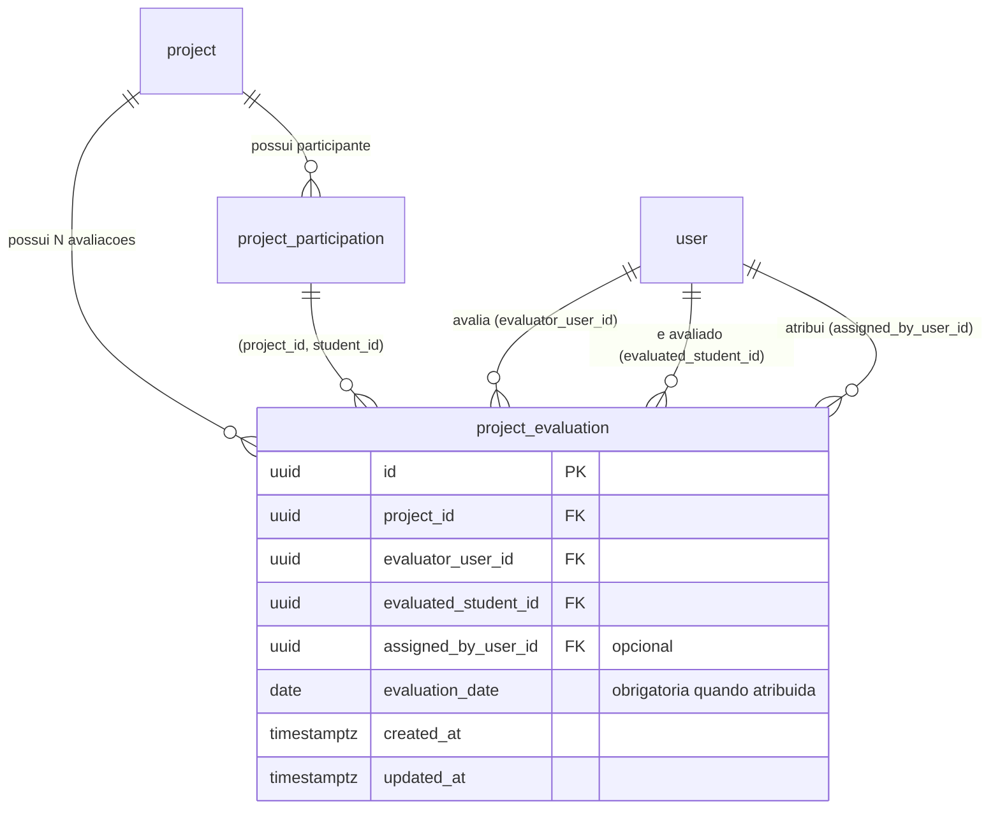

# Persistência de Avaliações Individuais sem Banca (DB-009)

Este documento descreve a modelagem relacional, as restrições de integridade, os índices, a compatibilidade com entregas subsequentes e o registro explícito das regras funcionais pendentes de validação formal do Product Owner (André) para a entrega **DB-009** (`migrations/V0009__create_project_evaluation.sql`), em conformidade com a **ADR-011**, convenções da **DB-001**, estrutura de projetos e participações da **DB-008** (`V0008`), **SPEC-PI-002**, **SPEC-PI-003** e o **Caderno de Validações de Escopo**.

---

## 1. Objetivo e Escopo Implementado

Modelar avaliações individuais vinculadas ao projeto, ao usuário avaliador e ao aluno participante avaliado, suportando quantidade variável de avaliações por projeto **sem entidade, agenda, sala ou link de banca** e sem cristalizar no schema regras funcionais ainda dependentes de validação formal do PO.

### 1.1 Mapeamento do Escopo Aprovado (Issue #9)

| Regra Definida no Escopo | Atendimento no Banco (`V0009`) |
| :--- | :--- |
| **Avaliador referencia um usuário existente** | `evaluator_user_id uuid NOT NULL` com FK `project_evaluation_evaluator_user_fk` para `auth."user"(id)` (`ON DELETE RESTRICT`). |
| **Avaliado é um aluno participante do projeto** | `evaluated_student_id uuid NOT NULL` com FK `project_evaluation_evaluated_user_fk` para `auth."user"(id)` e FK composta `project_evaluation_participation_fk (project_id, evaluated_student_id)` referenciando `academic_pi.project_participation (project_id, student_id)` (`ON DELETE RESTRICT`). |
| **Quantidade variável de avaliações por projeto** | Relação `1:N` aberta entre `academic_pi.project` e `academic_pi.project_evaluation`, sem colunas fixas de avaliadores e sem triggers/limites artificiais de cardinalidade. |
| **Alunos avaliam alunos; na Extensão, docentes adicionam avaliações; no PI, coordenação atribui aluno avaliador, projeto e data** | `evaluator_user_id` referencia `auth."user"` (permitindo discentes, docentes responsáveis e docentes externos ao projeto na Extensão); `assigned_by_user_id` (`FK -> auth."user"`) e `evaluation_date` (`date`) registram a atribuição quando aplicável, protegidos por `project_evaluation_assignment_ck`. |
| **Sem banca, agenda, sala, link, regra de conflito ou visibilidade adicional** | Nenhuma tabela ou coluna de banca, comitê, agendamento, sala, link de reunião, impedimento/conflito ou visibilidade especulativa foi criada. |
| **Compatibilidade com rubricas e notas de PI (DB-010)** | Restrição `project_evaluation_id_project_unq UNIQUE (id, project_id)` permite FK composta `(evaluation_id, project_id)` a partir de `academic_pi.evaluation_criterion_score`, impedindo vínculo cruzado entre avaliação e critério de projetos distintos. |

---

## 2. Modelo Relacional (`V0009__create_project_evaluation.sql`)

### 2.1 Colunas de `academic_pi.project_evaluation`

| Coluna | Tipo | Nulabilidade | Padrão | Finalidade |
| :--- | :--- | :--- | :--- | :--- |
| `id` | `uuid` | `NOT NULL` | — | Chave primária gerada pela aplicação (`DB-001`). |
| `project_id` | `uuid` | `NOT NULL` | — | Projeto ao qual a avaliação pertence (`academic_pi.project.id`). |
| `evaluator_user_id` | `uuid` | `NOT NULL` | — | Usuário avaliador (`auth."user".id`). |
| `evaluated_student_id` | `uuid` | `NOT NULL` | — | Aluno participante avaliado (`auth."user".id` + `project_participation`). |
| `assigned_by_user_id` | `uuid` | `NULL` | — | Usuário que atribuiu a avaliação (ex.: coordenação no PI); `NULL` em avaliações não atribuídas previamente. |
| `evaluation_date` | `date` | `NULL` | — | Data atribuída para a avaliação quando há atribuição (`assigned_by_user_id IS NOT NULL`). |
| `created_at` | `timestamptz` | `NOT NULL` | `now()` | Timestamp UTC de criação do registro. |
| `updated_at` | `timestamptz` | `NOT NULL` | `now()` | Timestamp UTC da última atualização. |

### 2.2 Restrições de Integridade (Constraints)

| Nome | Tipo | Definição / Regra |
| :--- | :--- | :--- |
| `project_evaluation_pkey` | `PRIMARY KEY` | `(id)` |
| `project_evaluation_project_fk` | `FOREIGN KEY` | `(project_id) REFERENCES academic_pi.project (id) ON DELETE RESTRICT` |
| `project_evaluation_evaluator_user_fk` | `FOREIGN KEY` | `(evaluator_user_id) REFERENCES auth."user" (id) ON DELETE RESTRICT` |
| `project_evaluation_evaluated_user_fk` | `FOREIGN KEY` | `(evaluated_student_id) REFERENCES auth."user" (id) ON DELETE RESTRICT` |
| `project_evaluation_participation_fk` | `FOREIGN KEY` | `(project_id, evaluated_student_id) REFERENCES academic_pi.project_participation (project_id, student_id) ON DELETE RESTRICT` |
| `project_evaluation_assigned_by_user_fk` | `FOREIGN KEY` | `(assigned_by_user_id) REFERENCES auth."user" (id) ON DELETE RESTRICT` |
| `project_evaluation_assignment_ck` | `CHECK` | `(assigned_by_user_id IS NULL) = (evaluation_date IS NULL)` |
| `project_evaluation_id_project_unq` | `UNIQUE` | `(id, project_id)` |

> Todas as chaves estrangeiras utilizam `ON DELETE RESTRICT`, preservando o histórico acadêmico e impedindo registros órfãos.

### 2.3 Índices

- `idx_project_evaluation_project_id` em `(project_id)` — listagem e agregação de avaliações por projeto.
- `idx_project_evaluation_evaluator_user_id` em `(evaluator_user_id)` — consulta de avaliações atribuídas/realizadas por avaliador.
- `idx_project_evaluation_evaluated_student_id` em `(evaluated_student_id)` — consulta de avaliações recebidas pelo aluno.
- `idx_project_evaluation_assigned_by_user_id` parcial em `(assigned_by_user_id) WHERE assigned_by_user_id IS NOT NULL` — rastreio de atribuições e verificação eficiente da FK opcional.

---

## 3. Regras Funcionais Pendentes de Validação pelo André (Não Cristalizadas)

Conforme a seção **"Validação pendente do André"** da Issue #9, os pontos abaixo **não foram inferidos nem cristalizados prematuramente no schema**, devendo ser evoluídos via migration incremental caso venham a ser formalmente aprovados:

1. **Autorização detalhada de avaliadores na Extensão:** o schema exige apenas que `evaluator_user_id` seja um usuário válido em `auth."user"`, permitindo que docentes não cadastrados em `academic_pi.project_instructor` adicionem avaliações na Extensão; a regra fina de autorização por papel/vínculo permanece na camada de aplicação/RBAC até validação formal.
2. **Relação entre atribuições discentes e avaliações docentes (unicidade por tripla):** não foi imposta constraint `UNIQUE (project_id, evaluator_user_id, evaluated_student_id)`, pois ainda não está validado se um mesmo avaliador pode avaliar o mesmo aluno em múltiplas rodadas/datas de um mesmo projeto ou se avaliação espontânea coexiste com atribuição.
3. **Autoavaliação (`evaluator_user_id <> evaluated_student_id`):** não foi adicionada restrição bloqueando autoavaliação sem decisão formal registrada pelo PO.
4. **Status da participação exigido no momento da avaliação:** a FK composta `project_evaluation_participation_fk` garante que o aluno avaliado possua vínculo registrado em `academic_pi.project_participation`, sem impor trigger bloqueando transições históricas de status (`approved`, `withdrawn`, `removed`) antes de definição formal sobre histórico e prazos.
5. **Estados e prazos da avaliação:** não foram criadas colunas especulativas de `status`, `deadline`/`opens_at`/`closes_at` de avaliação ou bloqueios temporais por trigger.
6. **Visibilidade de dados individuais por papel:** o banco não cria views restritivas ou colunas de visibilidade especulativas antes da definição de quais dados individuais cada papel (`ALUNO`, `DOCENTE`, `COORDENACAO`) pode consultar.

---

## 4. Compatibilidade e Pontos de Atenção com a DB-010

A modelagem da `V0009` foi alinhada com a entrega `DB-010` (rubricas e notas de PI):

- **Alinhamentos garantidos:** mesmo nome de tabela (`academic_pi.project_evaluation`), mesmas colunas-base (`id`, `project_id`, `evaluator_user_id`, `evaluated_student_id`, `assigned_by_user_id`, `evaluation_date`, `created_at`, `updated_at`), mesmos nomes de FKs, check (`project_evaluation_assignment_ck`), unique (`project_evaluation_id_project_unq`) e mesmos quatro índices (`idx_project_evaluation_*`).
- **Ajustes necessários na branch da DB-010 ao rebases sobre `develop` após o merge da DB-009:**
  1. Na `V0010`, substituir o `CREATE TABLE IF NOT EXISTS academic_pi.project_evaluation (...)` (que seria ignorado por a tabela já existir na `V0009`) por `ALTER TABLE academic_pi.project_evaluation ADD COLUMN IF NOT EXISTS ...` para adicionar as colunas específicas do fluxo de rubrica/finalização/reabertura/correção docente da `DB-010` (`overall_feedback`, `finalized_at`, `finalized_by_instructor_id`, `reopened_at`, `reopened_by_instructor_id`, `corrected_at`, `corrected_by_instructor_id`) e suas respectivas constraints.
  2. Revisar na `V0010` as constraints `project_evaluation_triplet_unq` e `project_evaluation_distinct_actors_ck`, que não pertencem ao escopo aprovado sem validação do André.
  3. Ajustar o passo final de verificação de resíduos da `DB-010` em `scripts/validate.sh`, que atualmente assume `count(*) = 0` em `academic_pi.project_evaluation`, para considerar os 6 registros determinísticos introduzidos em `seeds/0006_project_evaluation.sql`.
