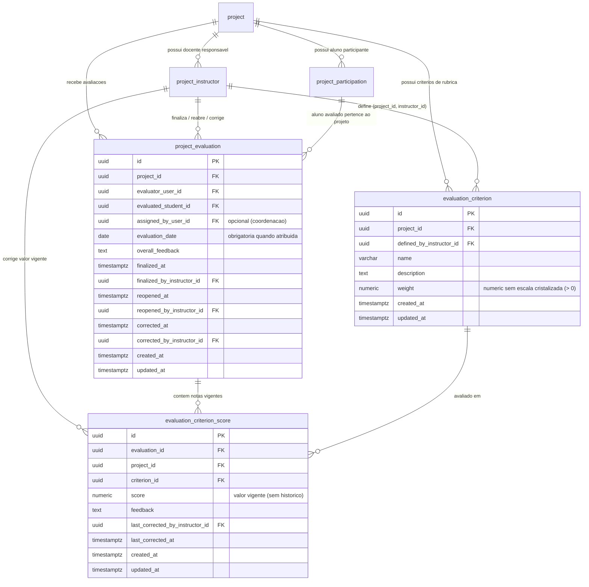

# Rubricas, Critérios e Avaliações de PI sem Cristalização de Regras Pendentes (DB-010)

Este documento estabelece a especificação arquitetural, o modelo relacional, as restrições de integridade e o registro formal dos bloqueios de produto para a persistência de critérios/rubricas e avaliações de Projetos Integradores (PI) no repositório `plataforma-database`, em conformidade com a **ADR-002**, **ADR-011**, convenções da **DB-001**, modelo de projetos da **DB-008** (`V0008`), diretrizes de avaliação individual da **DB-009**, **SPEC-PI-002**, **SPEC-PI-003** e o **Caderno de Validações de Escopo**.

---

## 1. Objetivo e Escopo Definido

A entrega **DB-010** (`migrations/V0010__create_pi_rubric_and_evaluation.sql`) persiste os critérios e pesos da rubrica do PI e as avaliações individuais vinculadas a projeto, avaliador e aluno avaliado, **sem cristalizar regras de escala, precisão, arredondamento, agregação, estados ou prazos** que ainda aguardam validação formal do Product Owner (André).

### 1.1 Matriz de Regras Aprovadas e Atendimento no Banco

| Regra Definida no Escopo (Caderno / SPEC-PI-002 / SPEC-PI-003) | Como o Banco de Dados Atende (`V0010`) |
| :--- | :--- |
| **Critérios do PI têm nome e peso e são definidos pelo docente responsável** | Tabela `academic_pi.evaluation_criterion` com `name` não vazio (`evaluation_criterion_name_ck`), `weight > 0` (`evaluation_criterion_weight_positive_ck`), unicidade por projeto (`evaluation_criterion_project_name_unq`) e FK composta `evaluation_criterion_instructor_fk (project_id, defined_by_instructor_id)` referenciando `academic_pi.project_instructor (project_id, instructor_id)`. |
| **Avaliação vincula-se ao projeto, avaliador e aluno avaliado, sem banca/agenda (DB-009)** | Tabela `academic_pi.project_evaluation` vinculando `project_id` (`academic_pi.project`), `evaluator_user_id` (`auth.user`) e `evaluated_student_id` (`auth.user` + FK composta `project_evaluation_participation_fk` para `academic_pi.project_participation`), permitindo quantidade variável de avaliações por projeto e impedindo autoavaliação (`project_evaluation_distinct_actors_ck`). Nenhuma tabela ou coluna de banca, sala, agenda ou link foi criada. |
| **Coordenação atribui aluno avaliador, projeto e data** | Colunas `assigned_by_user_id` (`FK -> auth.user`) e `evaluation_date` (`date`) em `academic_pi.project_evaluation`, com a restrição `project_evaluation_assignment_ck` (`assigned_by_user_id IS NULL OR evaluation_date IS NOT NULL`). |
| **Docente responsável é quem finaliza, reabre ou corrige a avaliação** | Colunas `finalized_at`/`finalized_by_instructor_id`, `reopened_at`/`reopened_by_instructor_id` e `corrected_at`/`corrected_by_instructor_id` em `academic_pi.project_evaluation`, todas protegidas por FKs compostas `(project_id, *_by_instructor_id)` para `academic_pi.project_instructor (project_id, instructor_id)` e checks de consistência temporal. |
| **Não guardar histórico de valores anteriores; correção substitui o valor vigente** | Tabela `academic_pi.evaluation_criterion_score` com restrição única `evaluation_criterion_score_eval_criterion_unq (evaluation_id, criterion_id)` e sem colunas de valor anterior ou tabela de histórico. A retificação pelo docente responsável (`evaluation_criterion_score_corrected_by_instructor_fk`) atualiza `score` *in-place* via `UPDATE` (`AC-PI-003-05`, `DB-007`). |

---

## 2. Diagrama Entidade-Relacionamento (`academic_pi`)

---

## 3. Especificação Estrutural (`V0010__create_pi_rubric_and_evaluation.sql`)

### 3.1 `academic_pi.evaluation_criterion`
Armazena os critérios e pesos da ficha/rubrica definidos pelo docente responsável pelo projeto.

| Coluna | Tipo | Nulo | Padrão | Regra / Finalidade |
| :--- | :--- | :--- | :--- | :--- |
| `id` | `uuid` | `NOT NULL` | — | PK |
| `project_id` | `uuid` | `NOT NULL` | — | FK `academic_pi.project(id)` (`ON DELETE RESTRICT`) |
| `defined_by_instructor_id` | `uuid` | `NOT NULL` | — | FK `auth.user(id)` e FK composta `(project_id, defined_by_instructor_id)` para `academic_pi.project_instructor` |
| `name` | `varchar(200)` | `NOT NULL` | — | Nome do critério (`length(trim(name)) > 0`), único por projeto |
| `description` | `text` | `NULL` | — | Descrição detalhada opcional do critério |
| `weight` | `numeric` | `NOT NULL` | — | Peso positivo (`weight > 0`) sem precisão/escala cristalizada |
| `created_at` | `timestamptz` | `NOT NULL` | `now()` | Instante de criação em UTC |
| `updated_at` | `timestamptz` | `NOT NULL` | `now()` | Instante da última atualização em UTC |

- **Constraints:** `evaluation_criterion_project_fk`, `evaluation_criterion_defined_by_user_fk`, `evaluation_criterion_instructor_fk`, `evaluation_criterion_name_ck`, `evaluation_criterion_weight_positive_ck`, `evaluation_criterion_project_name_unq`, `evaluation_criterion_id_project_unq`.
- **Índices:** `idx_evaluation_criterion_project_id`, `idx_evaluation_criterion_defined_by_instructor_id`.

### 3.2 `academic_pi.project_evaluation`
Representa a avaliação individual vinculada ao projeto, ao usuário avaliador e ao aluno participante avaliado.

| Coluna | Tipo | Nulo | Padrão | Regra / Finalidade |
| :--- | :--- | :--- | :--- | :--- |
| `id` | `uuid` | `NOT NULL` | — | PK |
| `project_id` | `uuid` | `NOT NULL` | — | FK `academic_pi.project(id)` (`ON DELETE RESTRICT`) |
| `evaluator_user_id` | `uuid` | `NOT NULL` | — | FK `auth.user(id)` (`ON DELETE RESTRICT`); usuário avaliador (aluno ou docente) |
| `evaluated_student_id` | `uuid` | `NOT NULL` | — | FK `auth.user(id)` e FK composta `(project_id, evaluated_student_id)` para `academic_pi.project_participation` |
| `assigned_by_user_id` | `uuid` | `NULL` | — | FK `auth.user(id)`; preenchido quando a coordenação atribui o avaliador |
| `evaluation_date` | `date` | `NULL` | — | Data atribuída para a avaliação (obrigatória quando `assigned_by_user_id IS NOT NULL`) |
| `overall_feedback` | `text` | `NULL` | — | Observação geral opcional da avaliação |
| `finalized_at` / `finalized_by_instructor_id` | `timestamptz` / `uuid` | `NULL` | — | Registro de finalização pelo docente responsável do projeto |
| `reopened_at` / `reopened_by_instructor_id` | `timestamptz` / `uuid` | `NULL` | — | Registro de reabertura pelo docente responsável do projeto |
| `corrected_at` / `corrected_by_instructor_id` | `timestamptz` / `uuid` | `NULL` | — | Registro de correção pelo docente responsável do projeto |
| `created_at` / `updated_at` | `timestamptz` | `NOT NULL` | `now()` | Rastreabilidade temporal em UTC |

- **Constraints:** `project_evaluation_project_fk`, `project_evaluation_evaluator_user_fk`, `project_evaluation_evaluated_user_fk`, `project_evaluation_participation_fk`, `project_evaluation_assigned_by_user_fk`, `project_evaluation_finalized_by_instructor_fk`, `project_evaluation_reopened_by_instructor_fk`, `project_evaluation_corrected_by_instructor_fk`, `project_evaluation_distinct_actors_ck`, `project_evaluation_assignment_ck`, `project_evaluation_finalization_ck`, `project_evaluation_reopen_ck`, `project_evaluation_correction_ck`, `project_evaluation_triplet_unq`, `project_evaluation_id_project_unq`.
- **Índices:** `idx_project_evaluation_project_id`, `idx_project_evaluation_evaluator_user_id`, `idx_project_evaluation_evaluated_student_id`, `idx_project_evaluation_assigned_by_user_id`.

### 3.3 `academic_pi.evaluation_criterion_score`
Armazena exclusivamente o valor vigente atribuído a cada critério em uma avaliação.

| Coluna | Tipo | Nulo | Padrão | Regra / Finalidade |
| :--- | :--- | :--- | :--- | :--- |
| `id` | `uuid` | `NOT NULL` | — | PK |
| `evaluation_id` | `uuid` | `NOT NULL` | — | FK composta `(evaluation_id, project_id)` para `academic_pi.project_evaluation(id, project_id)` |
| `project_id` | `uuid` | `NOT NULL` | — | Garante que a avaliação e o critério pertençam ao mesmo projeto |
| `criterion_id` | `uuid` | `NOT NULL` | — | FK composta `(criterion_id, project_id)` para `academic_pi.evaluation_criterion(id, project_id)` |
| `score` | `numeric` | `NOT NULL` | — | Valor vigente da nota do critério (sem escala/limite fixado até aprovação do PO) |
| `feedback` | `text` | `NULL` | — | Comentário opcional sobre o critério |
| `last_corrected_by_instructor_id` | `uuid` | `NULL` | — | FK composta `(project_id, last_corrected_by_instructor_id)` para `academic_pi.project_instructor` |
| `last_corrected_at` | `timestamptz` | `NULL` | — | Instante da última correção in-place |
| `created_at` / `updated_at` | `timestamptz` | `NOT NULL` | `now()` | Rastreabilidade temporal em UTC |

- **Constraints:** `evaluation_criterion_score_evaluation_fk`, `evaluation_criterion_score_criterion_fk`, `evaluation_criterion_score_corrected_by_instructor_fk`, `evaluation_criterion_score_correction_ck`, `evaluation_criterion_score_eval_criterion_unq`.
- **Índices:** `idx_evaluation_criterion_score_evaluation_id`, `idx_evaluation_criterion_score_criterion_id`, `idx_evaluation_criterion_score_project_id`.

---

## 4. Bloqueio de Produto (André) — O que Não Foi Cristalizado

Em estrita observância à seção **"Bloqueio de produto — André"** da Issue #10 (`DB-010`) e à `SPEC-PI-003 (AC-PI-003-01)`:

1. **Escala e precisão das notas e pesos (ex.: proposta de `0–100` inteiro mencionada no material):**
   - As colunas `evaluation_criterion.weight` e `evaluation_criterion_score.score` foram declaradas como `numeric` sem parâmetros `(precision, scale)` e **sem `CHECK` de intervalo de escala** (como `score BETWEEN 0 AND 100` ou `score = trunc(score)`).
   - Quando a decisão formal do PO for registrada, uma migration incremental adicionará a constraint de faixa/escala aprovada.
2. **Soma dos pesos e fórmula de agregação/arredondamento:**
   - O banco não exige que a soma de `weight` por projeto seja igual a `100` nem implementa função/view de média ponderada ou arredondamento.
3. **Avaliação ausente e obrigatoriedade de todos os critérios:**
   - O schema permite registrar notas por critério à medida que são lançadas, deixando o tratamento de avaliação ausente ou critério não preenchido no cálculo consolidado para a regra formal a ser aprovada.
4. **Estados formais e prazos da avaliação:**
   - Não foi criada coluna `status` com máquina de estados especulativa nem trava temporal baseada em prazo de entrega/avaliação. As ações já aprovadas no Caderno (finalizar, reabrir e corrigir pelo docente responsável) são registradas diretamente por carimbo de tempo e FK para `academic_pi.project_instructor`.
5. **Titularidade da nota consolidada (aluno, projeto ou ambos):**
   - Não foi adicionada coluna de nota consolidada final em `academic_pi.project` nem em `academic_pi.project_participation`.
6. **Seeds e testes de cálculo condicionados:**
   - Não foram adicionados seeds globais de notas com escala arbitrária, e os testes de limites numéricos de escala, precisão decimal, arredondamento, cálculo ponderado e ausência de avaliação ficam condicionados à aprovação formal das regras pelo PO.
