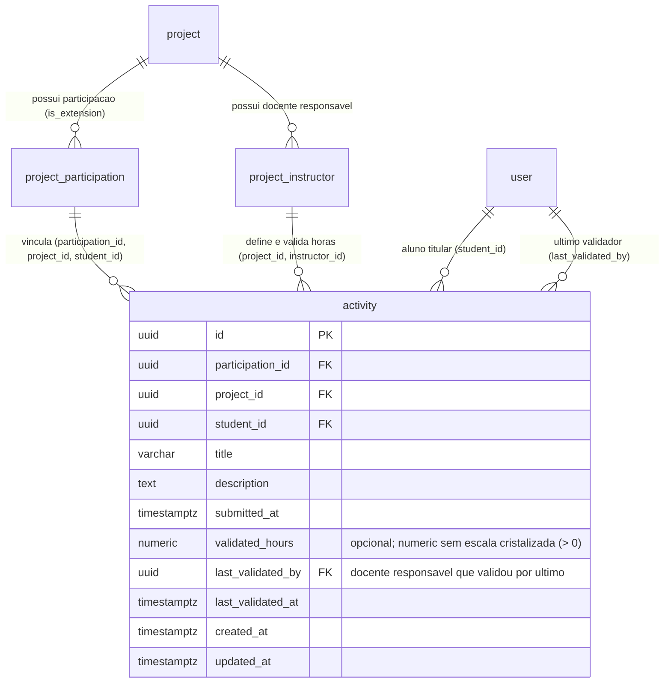

# Atividades e Horas Vigentes de Extensão sem Histórico (DB-013)

Este documento estabelece a modelagem relacional, as restrições de integridade, a validação de janela temporal e o registro formal das decisões pendentes do Product Owner (André) para a entrega **DB-013** (`migrations/V0013__create_extension_activities_hours.sql`), reconciliada sobre a linhagem atual da `develop` em conformidade com a **ADR-011**, convenções da **DB-001**, reconciliação de auditoria técnica da **DB-007** (`V0007`), modelo de projetos e participações da **DB-008** (`V0008`), reconciliação de janelas e inscrições da **DB-012** e a **Issue #13**.

---

## 1. Objetivo e Reconciliação com o PR #48

O PR #48 original (aplicado anteriormente na linhagem antiga da `main`) criou uma versão preliminar de `extension.activity` que referenciava tabelas inexistentes na `develop` (`academic_pi.project_participant`, `period_id`), não restringia a validação ao docente responsável pelo projeto e cristalizava regras ainda bloqueadas pelo PO (`requested_hours`, escala `numeric(6,2)` em frações de `0.25..100`, máquina de estados `SUBMITTED`/`APPROVED`/`REJECTED` e `rejection_reason`).

A `V0013` reconciliada na `develop` preserva a entidade `extension.activity` e corrige integralmente o modelo para atender às regras aprovadas na **Issue #13**:

| Regra Definida (Issue #13 / Caderno) | Atendimento no Banco (`V0013`) |
| :--- | :--- |
| **Atividade vinculada à participação do aluno** | FK `activity_participation_fk (participation_id -> academic_pi.project_participation.id)`, FK composta `activity_project_student_participation_fk (project_id, student_id -> academic_pi.project_participation)` e trigger `activity_participation_and_window_trg` exigindo coerência exata entre `participation_id` e `(project_id, student_id)`, categoria `is_extension = true` e participação `approved` no envio/edição. |
| **Aluno envia ou corrige durante o período do projeto; após o encerramento do prazo aplicável, não pode enviar nem alterar** | `activity_participation_and_window_trg` valida `submitted_at` contra `[project.starts_at, project.ends_at]` na inserção e exige que edições discentes (`title`, `description`, `submitted_at` ou vínculo) ocorram apenas enquanto o período do projeto não estiver encerrado (`ends_at IS NULL` em projetos contínuos ou `now() <= ends_at`). |
| **Somente o docente responsável define a quantidade de horas e valida as horas** | Não há coluna `requested_hours` discente; `validated_hours` exige conjuntamente `last_validated_by` e `last_validated_at` (`activity_validation_consistency_ck`), e a FK composta `activity_last_validated_by_instructor_fk (project_id, last_validated_by)` referencia `academic_pi.project_instructor (project_id, instructor_id)`. |
| **Guarda somente o valor vigente e quem validou por último; alteração substitui o valor vigente** | Atualizações de texto (no prazo) ou revalidações de horas pelo docente responsável sobrescrevem a própria linha via `UPDATE`, atualizando `validated_hours`, `last_validated_by` e `last_validated_at`. |
| **Sem valores antigos, motivos anteriores ou histórico de decisões** | Nenhuma tabela de histórico/log de negócio nem colunas de valor anterior, status especulativo ou motivo de recusa foram criadas (alinhado também à `DB-007`). |

---

## 2. Modelo Relacional (`V0013__create_extension_activities_hours.sql`)

### 2.1 Colunas de `extension.activity`

| Coluna | Tipo | Nulabilidade | Padrão | Finalidade |
| :--- | :--- | :--- | :--- | :--- |
| `id` | `uuid` | `NOT NULL` | — | Chave primária gerada pela aplicação (`DB-001`). |
| `participation_id` | `uuid` | `NOT NULL` | — | FK para `academic_pi.project_participation(id)` (`ON DELETE RESTRICT`). |
| `project_id` | `uuid` | `NOT NULL` | — | FK para `academic_pi.project(id)` (`ON DELETE RESTRICT`). |
| `student_id` | `uuid` | `NOT NULL` | — | FK para `auth."user"(id)` (`ON DELETE RESTRICT`). |
| `title` | `varchar(200)` | `NOT NULL` | — | Título vigente da atividade (`length(trim(title)) > 0`). |
| `description` | `text` | `NOT NULL` | — | Descrição vigente da atividade (`length(trim(description)) > 0`). |
| `submitted_at` | `timestamptz` | `NOT NULL` | `now()` | Instante vigente do envio/correção das informações pelo aluno (UTC). |
| `validated_hours` | `numeric` | `NULL` | — | Quantidade vigente de horas definida e validada pelo docente responsável (`> 0` quando preenchida; sem precisão/escala cristalizada). |
| `last_validated_by` | `uuid` | `NULL` | — | Identificação do docente responsável pelo projeto que validou as horas por último. |
| `last_validated_at` | `timestamptz` | `NULL` | — | Instante UTC da última validação de horas pelo docente responsável. |
| `created_at` | `timestamptz` | `NOT NULL` | `now()` | Instante UTC de criação do registro. |
| `updated_at` | `timestamptz` | `NOT NULL` | `now()` | Instante UTC da última atualização. |

### 2.2 Restrições de Integridade, Índices e Trigger

- **Foreign Keys (`ON DELETE RESTRICT`):**
  - `activity_participation_fk`: `(participation_id) -> academic_pi.project_participation (id)`
  - `activity_project_fk`: `(project_id) -> academic_pi.project (id)`
  - `activity_student_user_fk`: `(student_id) -> auth."user" (id)`
  - `activity_project_student_participation_fk`: `(project_id, student_id) -> academic_pi.project_participation (project_id, student_id)`
  - `activity_last_validated_by_user_fk`: `(last_validated_by) -> auth."user" (id)`
  - `activity_last_validated_by_instructor_fk`: `(project_id, last_validated_by) -> academic_pi.project_instructor (project_id, instructor_id)`
- **Check Constraints:**
  - `activity_title_ck`: `length(trim(title)) > 0`
  - `activity_description_ck`: `length(trim(description)) > 0`
  - `activity_validated_hours_positive_ck`: `validated_hours IS NULL OR validated_hours > 0`
  - `activity_validation_consistency_ck`: `(validated_hours IS NULL AND last_validated_by IS NULL AND last_validated_at IS NULL) OR (validated_hours IS NOT NULL AND last_validated_by IS NOT NULL AND last_validated_at IS NOT NULL)`
- **Índices:** `idx_activity_participation_id`, `idx_activity_project_id`, `idx_activity_student_id` e `idx_activity_last_validated_by` (parcial `WHERE last_validated_by IS NOT NULL`).
- **Trigger:** `activity_participation_and_window_trg` (`extension.validate_activity_participation_and_window()`), garantindo correspondência exata entre `participation_id` e `(project_id, student_id)`, categoria `is_extension = true`, participação `approved` no envio/edição discente e respeito ao período `[starts_at, ends_at]` do projeto nas alterações discentes, permitindo que o docente responsável valide/retifique horas mesmo após `ends_at`.

---

## 3. Decisões Pendentes de Validação pelo André (Não Cristalizadas)

Em cumprimento estrito à seção **"Validação pendente do André"** da Issue #13 e ao quarto critério de aceite, os pontos abaixo **não foram inferidos nem cristalizados no schema**:

1. **Unidade e limites numéricos de horas:** `validated_hours` utiliza `numeric` sem `(precision, scale)` e apenas exige `> 0` quando preenchido, sem impor passos de `0.25`, horas inteiras, minutos ou teto máximo (ex.: `100h`) até decisão formal.
2. **Estados formais da atividade:** não foi criada coluna `status` com enumeração especulativa (`SUBMITTED`, `APPROVED`, `REJECTED`, etc.); a presença ou ausência de validação vigente é representada diretamente pelo trio `(validated_hours, last_validated_by, last_validated_at)`.
3. **Tratamento/motivo de recusa e possibilidade de reenvio após recusa:** não foram criadas colunas `rejection_reason` ou contadores/travas de reenvio, pois dependem de definição sobre se uma recusa persiste motivo vigente, limpa campos ou bloqueia novo envio.
4. **Conflito R61/R62 sobre prorrogação/ajuste de prazo (Caderno itens 61 e 62, documentado na DB-012):** o banco consulta dinamicamente `starts_at` e `ends_at` em `academic_pi.project`, sem travar alterações de datas na tabela de projetos nem criar colunas/tabelas especulativas de prorrogação.

---

## 4. Fronteira de Autorização e Limitação de Identidade Banco vs. Backend

Conforme estabelecido na **DB-001 (§3.1 — Gestão Explícita de Roles diferida)**, a aplicação conecta-se ao PostgreSQL por meio de role técnica compartilhada, sem roles individuais por usuário final nem políticas especulativas de Row-Level Security (`RLS`) ou variáveis de sessão (`current_setting`) não padronizadas:

1. **O que o banco garante estruturalmente (`V0013`):**
   - `validated_hours` nunca existe sem `last_validated_by` e `last_validated_at` (`activity_validation_consistency_ck`);
   - `last_validated_by` referencia obrigatoriamente um docente cadastrado em `academic_pi.project_instructor (project_id, instructor_id)` para aquele projeto (`activity_last_validated_by_instructor_fk`), impedindo que o identificador de um aluno ou de um docente externo ao projeto seja gravado como validador;
   - alterações de conteúdo da atividade (`title`, `description`, `submitted_at` ou vínculo) fora da janela `[project.starts_at, project.ends_at]` são bloqueadas por trigger.
2. **O que depende do controle de identidade e RBAC no Backend (`DB-006`):**
   - Autenticar o usuário da sessão HTTP e vincular o ator autenticado a `student_id` (no envio/edição discente) e a `last_validated_by` (na definição/validação de horas pelo docente responsável), impedindo que uma chamada não autorizada forje o UUID de um docente responsável válido em `last_validated_by` ou edite atividades de outro aluno;
   - Restringir os endpoints de definição/alteração de `validated_hours` exclusivamente ao docente responsável autenticado e os endpoints de envio/correção textual ao participante titular autenticado.
