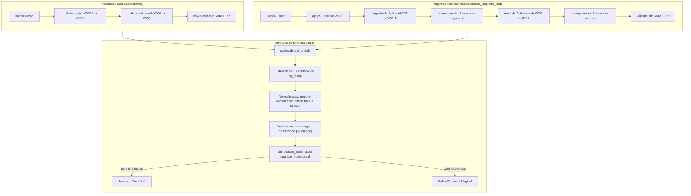

# Deteccao de Drift Estrutural e Fixtures Deterministicas (DB-016)

Este documento especifica a arquitetura e implementacao da deteccao automatica de drift estrutural entre instalacao limpa (*clean install*) e atualizacao incremental (*upgrade*), bem como o provisionamento de fixtures sinteticas deterministicas para as estruturas vigentes do banco de dados relacional (PostgreSQL 16).

---

## 1. Contexto e Objetivos

No ciclo de vida de evolucao de bancos de dados gerenciados por migrations, um dos riscos operacionais mais frequentes e o **schema drift**: situacoes em que uma instalacao nova a partir do zero produz um schema sutilmente diferente de um banco que passou por sucessivas migraes incrementais (por exemplo, constraints ausentes, tipos de dados divergentes, indices parciais omitidos ou sequencias desincronizadas).

A entrega **DB-016** resolve esse problema estabelecendo:

1. **Cobertura Integral de Migrations no Upgrade:** O teste de upgrade dinamico cobre todas as migrations da branch (incluindo V0006, V0007, V0008, V0011 e futuras versoes), sem listas estaticas desatualizadas.
2. **Deteccao Automatizada de Drift Estrutural:** Extracao e comparacao canonica do DDL final gerado na instalacao limpa e no banco resultante de upgrade incremental. Caso haja qualquer divergencia, a CI falha com diff legivel apontando as linhas discrepantes.
3. **Fixtures Deterministicas e Anti-PII para Entidades Vigentes:** Criacao de seeds sinteticos para as tabelas aprovadas de projetos e participacoes (`academic_pi.project`, `enrollment_period`, `project_instructor`, `project_participation`), passando pelas constraints reais sem dados pessoais.
4. **Idempotencia Comprovada:** Reaplicacao de migrations e de seeds sem falhas ou alteracoes colaterais.

---

## 2. Arquitetura da Deteccao de Drift

O fluxo de verificacao de equivalencia estrutural opera em conjunto com o ciclo de testes da CI:



---

## 3. Extracao e Normalizacao Canonica de Schemas

Para comparar com fidelidade os schemas gerados pelos dois metodos sem incorrer em falsos positivos decorrentes de metadados transientes:

1. **Extracao DDL (`pg_dump --schema-only`):** Extrai unicamente os objetos estruturais (tabelas, tipos, colunas, check constraints, foreign keys, chaves primarias, chaves unicas e indices). A opcao `--no-owner` e utilizada para garantir portabilidade independente do superusuario de execucao.
2. **Filtragem de Metadados e Comentarios:** Linhas iniciadas em `--` (cabecalhos com versao do pg_dump, datas/timestamps e comentarios de secao) sao descartadas.
3. **Filtragem de Estado Transiente de Sequencias (`setval`):** Sequencias serial geradas em `V0006` tem seus valores de controle interno (`SELECT pg_catalog.setval(...)`) excluidos da comparacao estrutural, visto que representam estado de insercao de dados e nao estrutura de schema.
4. **Normalizacao de Quebras de Linha e Espacos:** Conversao estrita para terminacao Unix (LF) e remocao de linhas vazias redundantes.

---

## 4. Fixtures Deterministicas Vigentes (`seeds/0005_project_tables.sql`)

Para suprir os dados sinteticos das tabelas introduzidas na `V0008` (`academic_pi`), foi criado o script deterministico `seeds/0005_project_tables.sql`:

| Tabela | Qtd Registros | Cenarios Cobertos | Constraints e Indices Validados |
| :--- | :--- | :--- | :--- |
| `academic_pi.project` | 4 | Categorias PI, Extensao e Hibrido (PI + Extensao); status `published`, `draft` e `archived`; publico e privado | `project_title_ck`, `project_category_ck`, `project_status_ck`, `project_period_ck`, `project_id_category_unq` |
| `academic_pi.enrollment_period` | 3 | Janelas regulares de inscricao associadas a projetos ativos | `enrollment_period_project_fk`, `enrollment_period_window_ck` |
| `academic_pi.project_instructor` | 3 | Docentes responsaveis associados a contas existentes em `auth.user` | `project_instructor_project_fk`, `project_instructor_user_fk`, `project_instructor_project_instructor_unq` |
| `academic_pi.project_participation` | 5 | Estudante com 1 PI + 1 Extensao ativos simultaneos (`approved`); participacao desistida (`withdrawn`); remocao justificada (`removed` com justificativa); solicitacao pendente (`requested`) | `project_participation_project_fk`, `project_participation_user_fk`, `project_participation_status_ck`, `project_participation_category_ck`, `project_participation_justification_ck`, `idx_project_participation_student_active_pi`, `idx_project_participation_student_active_extension` |

### Conformidade Anti-PII (LGPD)
- Todos os identificadores utilizam UUIDs deterministicos constantes (`b0000000-0000-4000-8000-00000000010X`, `d1...`, `d2...`, `d3...`).
- Titulos, descricoes e justificativas sao puramente academicos e ficticios.
- Zero uso de CPFs, e-mails comerciais ou nomes reais.

---

## 5. Como Executar

```bash
# Executa instalacao limpa completa
make up
make migrate
make seed
make validate

# Executa teste de upgrade e deteccao de drift
make validate-upgrade

# Ou invoca a deteccao de drift de forma direta (entre plataforma e outro banco)
./scripts/detect_drift.sh plataforma plataforma_upgrade_test

# Executa suite de testes integral
make test
```
