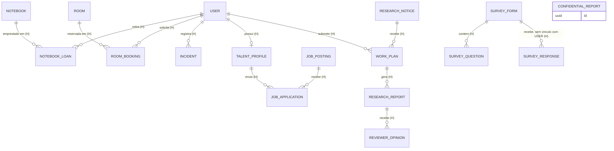

# DB-021: Modelo Draft dos domínios US14–18

**Status:** Draft para revisão do PO. Nada aqui é regra aprovada nem DDL executável. Toda entidade, campo e regra abaixo é **hipótese** até Produto aprovar (a PG-019 ainda não refinou as US14–18).

## 1. Fontes consultadas
- `plataforma-governance/_KB/product/modules.md` (módulos 4–7, Fase 2) e `_KB/product/scope.md`.
- `_KB/archive/legacy-2026-09-09/02-planning/backlog.md` (US14–18, legado, apenas referência).
- Apresentação de alinhamento com o cliente (slides): P2 Carreira e IC, P3 Patrimônio, P4 CPA. Recado do slide 5: o banco "já deve prever o modelo relacional integrado".
- Caderno de Validações e escopo detalhado de banco (22/10/2026): o resultado desta issue é modelo Draft, sem migration de produto.

O Caderno **não** cobre nenhum destes domínios. Não há SPEC ativa para eles.

## 2. Mapa das histórias

| US | Domínio | Descrição conhecida | Prioridade (slides) |
|---|---|---|---|
| US14 | Patrimônio: notebooks | Inventário com QR Code, check-in/check-out de empréstimos, histórico de responsáveis | P3 |
| US15 | Patrimônio: salas e avarias | Agendamento de salas fora do horário com aprovação; registro de avarias com evidência fotográfica e histórico de resolução | P3 |
| US16 | Carreira | Perfil profissional (currículo, competências, portfólio); mural de vagas de estágio/trainee; candidaturas simplificadas | P2 |
| US17 | Iniciação Científica | Editais de bolsas; submissão de planos de trabalho; relatórios de pesquisa com pareceres | P2 |
| US18 | CPA e Ouvidoria | Formulários periódicos de autoavaliação e avaliação da cantina; canal confidencial/anônimo de relatos; painel de indicadores | P4 |

## 3. Atores (hipótese)
Aluno, Docente e Coordenação já existem no RBAC (DB-006). Os módulos mencionam também **CPA**, **Administrador** e **parecerista/orientador**; o Caderno não define esses papéis. Decisão pendente.

## 4. Entidades hipotéticas por domínio
Notação: `H` = hipótese não aprovada.

### US14: notebooks
- `notebook` (H): identificação, código do QR, estado.
- `notebook_loan` (H): notebook, usuário responsável, retirada, devolução.
- Histórico de responsáveis (H): derivável das devoluções/empréstimos; **conflita em espírito** com a decisão "sem histórico de valores" do Caderno. Precisa de decisão se vale como função de negócio.

### US15: salas e avarias
- `room` (H) e `room_booking` (H): período, solicitante, status de aprovação, aprovador.
- `incident` (H): avaria ligada a sala ou notebook, descrição, status.
- Evidência fotográfica (H): metadado de arquivo. A `assets.project_file` (DB-011) é ligada a projeto; reutilizar exige generalização ou tabela própria.
- Histórico de resolução (H): mesma dúvida de histórico acima.

### US16: carreira
- `talent_profile` (H), competências (H), itens de portfólio (H).
- `job_posting` (H): tipo (estágio, trainee), período, publicador.
- `job_application` (H): candidatura por perfil e vaga, uma por par (H).

### US17: iniciação científica
- `research_notice` (H): edital de bolsa, janela de inscrição (reusar padrão de `enrollment_period`).
- `work_plan` (H): plano submetido por aluno e orientador.
- `research_report` (H) e `reviewer_opinion` (H): parecer por parecerista.
- Sobreposição possível com `extension` e com avaliação de PI; decidir se reusa ou separa.

### US18: CPA e ouvidoria
- `survey_form`, `survey_question` (H): formulário dinâmico e periódico.
- `survey_response` (H): resposta **anônima**, sem vínculo direto com usuário. Exige cuidado: se houver controle de "já respondeu", ele não pode permitir reidentificação.
- `confidential_report` (H): relato confidencial a docente ou coordenação.
- Indicadores consolidados (H): painel agregado para autoavaliação do MEC; fórmulas indefinidas.

## 5. Relações com o que já existe
- `auth.user` e `institutional.academic_class`/vínculo acadêmico: base para todos os domínios (FK para usuário, `ON DELETE RESTRICT` como nas migrations atuais, H).
- Janelas e períodos: padrão de `enrollment_period` (V0008, DB-012) pode servir a editais de IC e vagas (H).
- Arquivos: ver US15 e US16 (portfólio).

### Diagrama de domínio (hipótese)

Incidentes (`INCIDENT`) também podem se referir a notebook ou sala; omitido para simplificar. Todas as relações e cardinalidades são hipóteses.

## 5.1 Volume e integrações (hipótese)
- **Volume:** não há estimativa nas fontes (alunos, notebooks, salas, vagas, respostas de formulário). A definir com Produto; só então decidir índices e particionamento.
- **Integrações previstas nos módulos:** geração e leitura de QR Code (US14), armazenamento de arquivos para fotos, portfólio e relatórios (política da SPEC-PI-004), exportação de indicadores para o relatório de autoavaliação do MEC (US18), autenticação e RBAC existentes.

## 6. Sensibilidade e retenção (a definir)
| Domínio | Sensibilidade | Pendência |
|---|---|---|
| US14 | Baixa a média | Retenção do histórico de empréstimos |
| US15 | Média: fotos podem conter menores ou terceiros | Critério de autorização de fotos (Caderno, itens 35 e 53) |
| US16 | Alta: dados pessoais e currículo (LGPD) | Base legal, retenção e exclusão |
| US17 | Média | Visibilidade de pareceres |
| US18 | **Muito alta**: anonimato e relatos confidenciais | Garantia de anonimato, acesso, retenção e eventual dado de menores |

A decisão do Caderno de não manter auditoria de negócio (SPEC-AUTH-004) precisa ser reconciliada com cada pedido de "histórico".

## 7. Alternativas de organização

| Opção | Descrição | Vantagens | Riscos |
|---|---|---|---|
| A | Um schema novo por domínio (patrimônio, carreira, IC, CPA) | Isolamento claro, permissões por schema | A convenção DB-001 define 5 schemas (`auth`, `academic_pi`, `extension`, `assets`, `institutional`); novos schemas exigem aprovação |
| B | Reusar os 5 schemas (`institutional` para patrimônio e CPA, `extension`/`academic_pi` para IC) | Sem mudar a convenção; segue o ADR-002 (schemas por domínio) | Schemas ficam heterogêneos |
| C | Motor genérico de formulários para CPA e candidaturas | Menos tabelas | Complexidade e risco de anonimato |

Recomendação preliminar (não aprovada): decidir A ou B com Segurança e Backend; tratar CPA (US18) como domínio isolado por causa do anonimato.

Dependências comuns às três: PG-019 (escopo), matriz RBAC com os novos papéis e a política de arquivos.

## 8. Riscos
- Modelar antes da refinação (PG-019) e retrabalhar.
- Anonimato da CPA quebrado por chaves, logs ou índices.
- Dados pessoais de currículo sem política de retenção.
- Histórico/trilha pedidos pelo produto contra a decisão do Caderno.
- Fotos de menores sem critério de publicação.
- Prioridades divergentes entre labels do GitHub, backlog e slides.

## 9. Decisões pendentes (Produto, Segurança, Backend)
1. Quais histórias de US14–18 entram em 2027.1 e em que ordem (PG-019).
2. Papéis CPA, Administrador e parecerista no RBAC.
3. Opção de organização de schemas (A, B ou C) e eventual alteração do ADR-002.
4. Histórico de empréstimos e de resolução de avarias é função de negócio permitida?
5. Política de retenção e anonimato da US18.
6. Regra de arquivos: fotos (US15) e portfólio (US16), generalizando ou não a DB-011.
7. Limites: quantidade de reservas, vagas por edital, tamanho de arquivos.

## 10. Estimativa do próximo trabalho (hipótese)
Depois da PG-019 e das decisões acima: um card de DB por domínio (US14, US15, US16, US17, US18), cada um com SPEC, modelo revisado, migration incremental, seed sintético e validação de upgrade, como nos cards de Sprint 1 e 2. Tamanho relativo estimado: US18 e US16 maiores (sensibilidade), US14 menor. Valores em SP só após a refinação.

## 11. Critério de aceite desta issue
Modelo Draft aceito pelo PO, riscos e dependências explícitos, sem implementação prematura. Evidências anexadas: este documento, decisões pendentes (seção 9), riscos (seção 8) e feedback do PO (a coletar).
